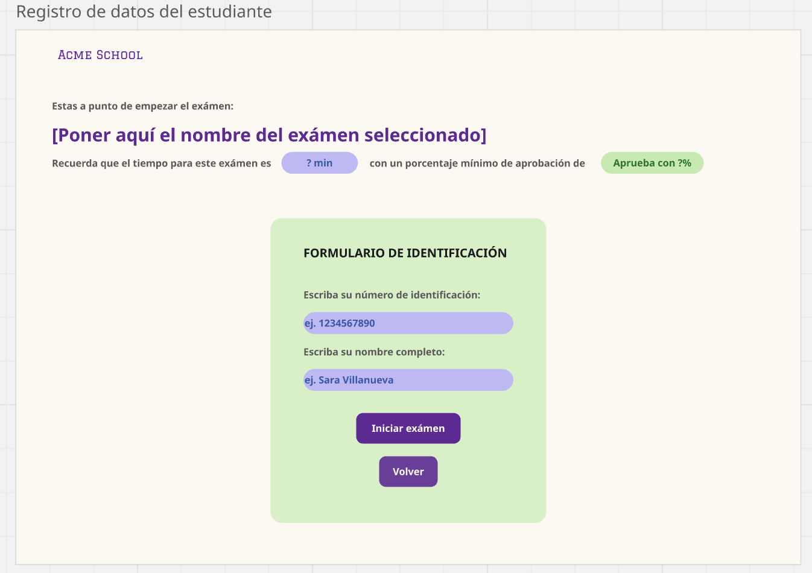
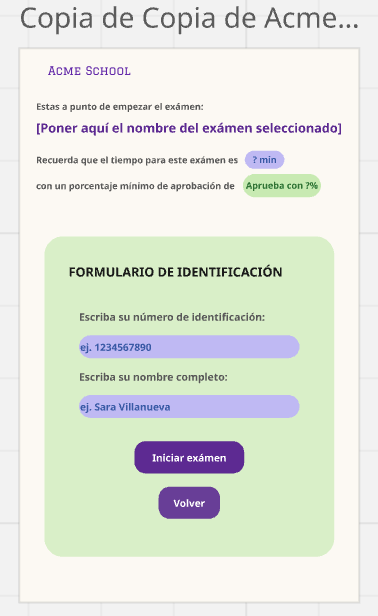
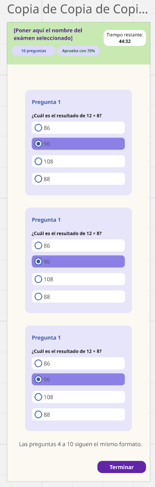
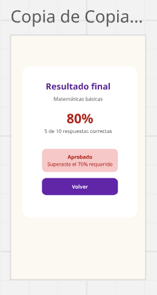
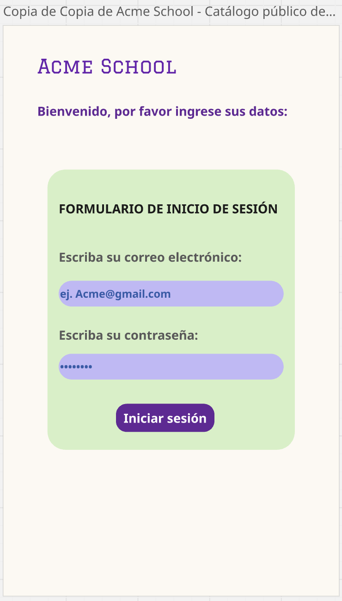
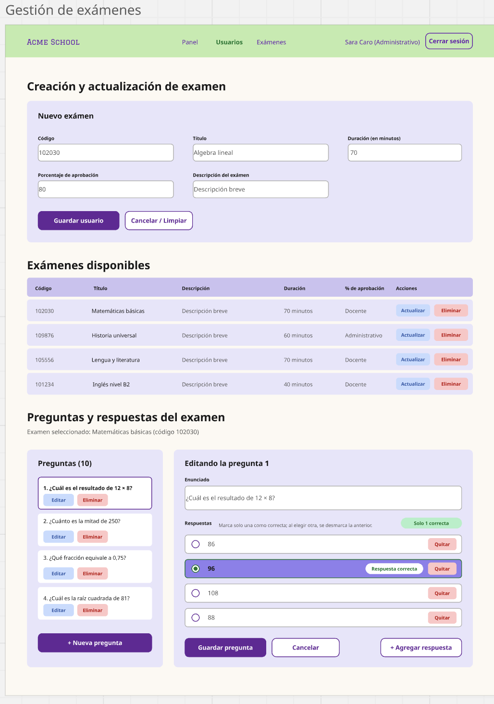
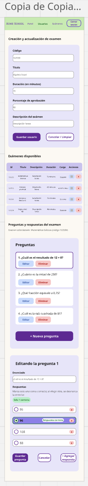

## Mockups

### 1. Vista Pública — Catálogo de Exámenes (`Pantalla inicial pública`)
Es el punto de entrada para los estudiantes, sin necesidad de autenticarse.

| Vista Escritorio | Vista Móvil |
| :---: | :---: |
|  |  |

### 2. Vista Pública — Registro de Datos del Estudiante (`Previo al examen`)
Aparece cuando el estudiante elige un examen del catálogo.

| Vista Escritorio | Vista Móvil |
| :---: | :---: |
|  |  |

### 3. Vista Pública — Resolución del Examen y Resultado Final
Es el núcleo de la experiencia del estudiante, con interfaz limpia, sin distracciones y sin bloqueos.

| Vista Escritorio | Vista Móvil |
| :---: | :---: |
|  |  |

#### Si el estudiante aprobó se mostrará: 
| Vista Escritorio | Vista Móvil |
| :---: | :---: |
|  |  |

#### Si el estudiante reprobó se mostrará:
| Vista Escritorio | Vista Móvil |
| :---: | :---: |
|  |  |

### 4. Vista Privada — Login
Vista inicial para acceder a los módulos administrativos de la plataforma.

| Vista Escritorio | Vista Móvil |
| :---: | :---: |
|  |  |

### 5. Vista Privada — Gestión de Usuarios
Accesible solo tras iniciar sesión.

| Vista Escritorio | Vista Móvil |
| :---: | :---: |
|  |  |

### 6. Vista Privada — Gestión de Exámenes (`y Preguntas/Respuestas`)
Accesible solo tras iniciar sesión.

| Vista Escritorio | Vista Móvil |
| :---: | :---: |
|  |  |
