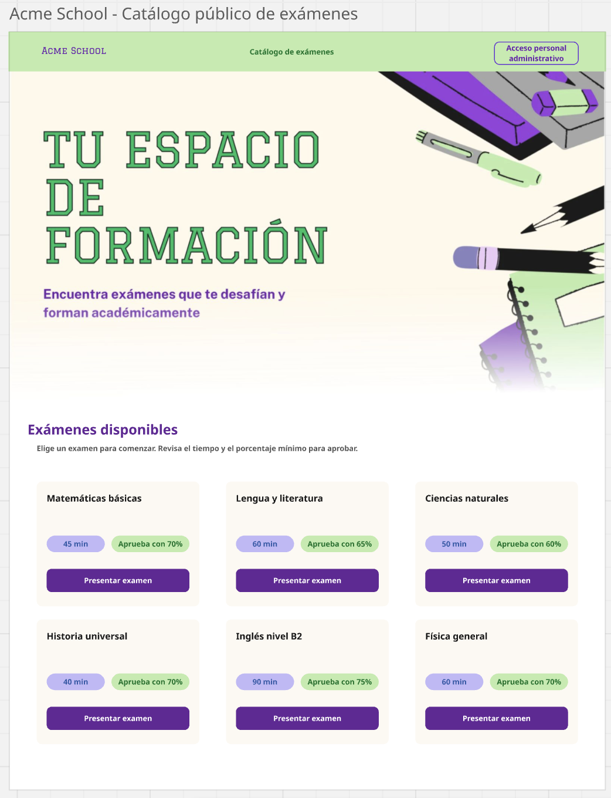
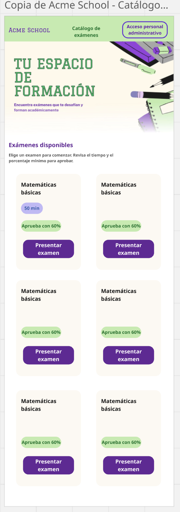
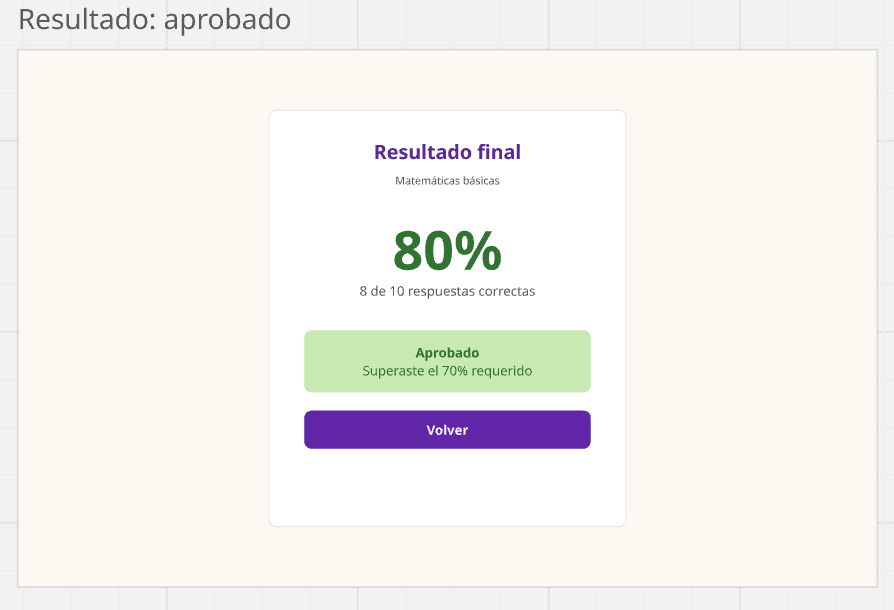
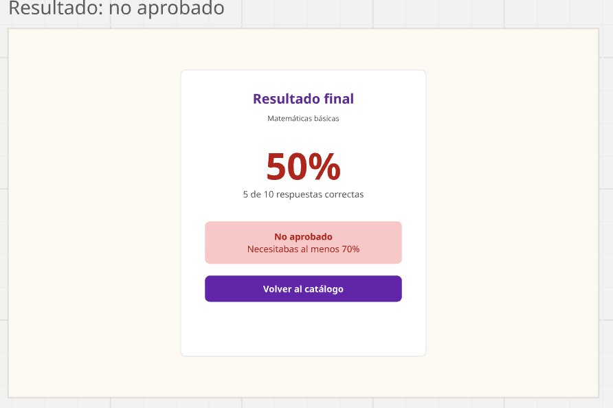
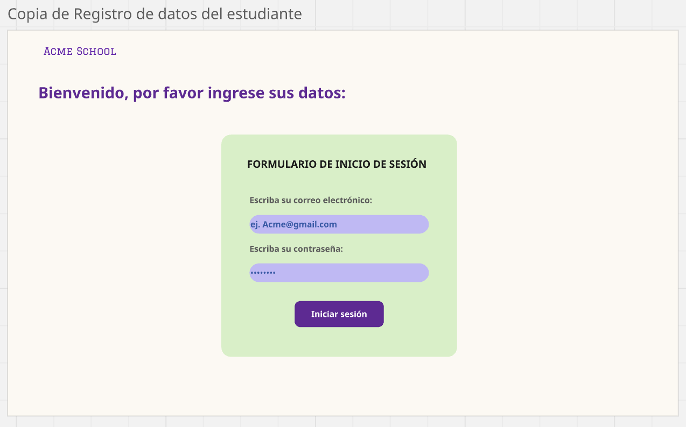
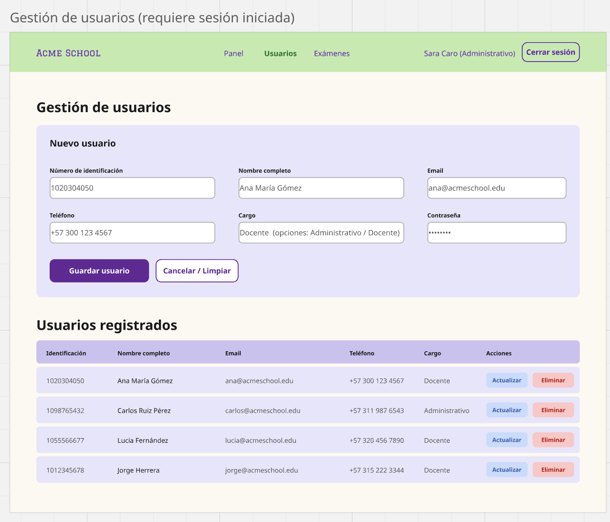
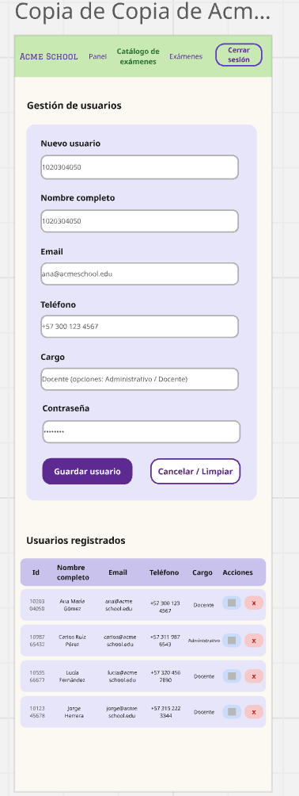

# 🎓 Acme School — Plataforma Web para Gestión y Resolución de Exámenes

**Acme School** es una aplicación web interactiva diseñada para que instituciones educativas gestionen evaluaciones en línea y sus estudiantes puedan presentar exámenes desde el navegador sin necesidad de crear una cuenta. El proyecto implementa una interfaz limpia, accesible y *responsive* con identidad visual institucional, arquitectura modular en **JavaScript (ES Modules)**, **Web Components** y persistencia local mediante `localStorage`.

---

## 📋 Tabla de Contenidos

1. [Descripción del Proyecto](#descripción-del-proyecto)
2. [Instrucciones de Visualización](#instrucciones-de-visualización)
3. [Tecnologías Utilizadas](#tecnologías-utilizadas)
4. [Estructura del Proyecto](#estructura-del-proyecto)
5. [Modelo de Datos (JSON y Persistencia)](#modelo-de-datos-json-y-persistencia)
6. [Capturas de Pantalla (Móvil y Escritorio)](#capturas-de-pantalla-móvil-y-escritorio)

---

## 📝 Descripción del Proyecto

La plataforma responde a la necesidad de **Acme School** de digitalizar tanto la administración interna de evaluaciones como su presentación pública por parte de los estudiantes, separando claramente los módulos privados (protegidos mediante autenticación) de la zona pública de evaluación.

### Módulos y Vistas Desarrolladas

* **Catálogo Público de Exámenes (`#view-catalog`):** Vista inicial accesible sin inicio de sesión. Presenta el *Hero* institucional (*"Tu espacio de formación"*) y una cuadrícula *responsive* con las evaluaciones disponibles, mostrando título, tiempo asignado en minutos, porcentaje mínimo para aprobar y número total de preguntas.
* **Registro del Estudiante (`#view-student-register`):** Antes de iniciar una prueba seleccionada, solicita el **número de identificación** y el **nombre completo** del estudiante para asociar su intento y calificación.
* **Resolución del Examen en Tiempo Real (`#view-exam-runner`):**
  * Encabezado con título del examen, cantidad total de preguntas, porcentaje mínimo de aprobación y reloj regresivo en vivo (`<exam-timer>`).
  * Listado numerado de preguntas donde el estudiante solo puede seleccionar una opción por pregunta.
  * Envío manual mediante el botón **Terminar** o cierre automático cuando el temporizador llega a `00:00`.
* **Resultado Final (`#view-exam-result`):** Calcula automáticamente el porcentaje de aciertos, informa el total de respuestas correctas y muestra el estado de **Aprobado** o **No aprobado** según el porcentaje configurado.
* **Inicio de Sesión (`#view-login`):** Vista de acceso privado mediante correo electrónico y contraseña para personal con cargo `Administrativo` o `Docente`. Bloquea la visualización y ejecución de los módulos de gestión cuando no existe una sesión activa.
* **Gestión de Usuarios (`#view-users`):** Módulo privado con formulario y tabla dinámica para crear, listar, actualizar y eliminar usuarios (número de identificación, nombre completo, correo electrónico, teléfono, cargo y contraseña), validando duplicados y protegiendo la sesión activa.
* **Gestión de Exámenes, Preguntas y Respuestas (`#view-exams`):** Módulo privado con CRUD completo de exámenes (código, título, duración en minutos, porcentaje de aprobación y descripción) y constructor de preguntas con múltiples opciones de respuesta, garantizando que **solo una opción** quede marcada como correcta por pregunta.

---

## 🚀 Instrucciones de Visualización

Debido a que el proyecto utiliza **Módulos ES (`type="module"`)** y **Web Components**, debe ejecutarse a través de un servidor local (no abriendo el archivo directamente con `file://`).

### Pasos para ejecutar localmente

1. **Clonar el repositorio:**
   ```bash
   git clone https://github.com/<tu-usuario>/ProyectoAcmeschool_JavaScript_VillanuevaSara.git
   ```
2. **Abrir en Visual Studio Code:**
   Abre la carpeta `ProyectoAcmeschool_JavaScript_VillanuevaSara` dentro de tu editor.
3. **Iniciar Live Server:**
   Haz clic derecho sobre `index.html` y selecciona **"Open with Live Server"** (o abre `http://127.0.0.1:5500/index.html` en tu navegador).

### Credenciales de Acceso de Prueba (Módulos Privados)

Al cargar la aplicación por primera vez, `JS/store.js` inicializa automáticamente datos semilla en `localStorage`:

* **Correo electrónico:** `admin@acmeschool.edu.co`
* **Contraseña:** `Acme2026!`

> **Nota:** Si deseas restaurar los datos iniciales de prueba en cualquier momento, puedes limpiar la clave `acme_school_db_v1` desde **DevTools (`F12`) → Application → Local Storage** y recargar la página.

---

## 🛠️ Tecnologías Utilizadas

* **HTML5 Semántico:** Estructura con jerarquía única de encabezado (`<h1>`), secciones dinámicas, etiquetas `<label>` vinculadas, `<fieldset>`/`<legend>` para preguntas y atributos de accesibilidad (`aria-labelledby`, `aria-live`).
* **CSS3 Moderno:** Sistema de diseño basado en variables `:root` (paleta institucional, tipografía, espaciados y bordes), **CSS Grid**, **Flexbox**, enfoque *Mobile-First* / *Responsive* y transiciones suaves con soporte para `prefers-reduced-motion`.
* **JavaScript (ES6+ Modular):** Arquitectura desacoplada mediante `import` y `export` para separar estado, autenticación, CRUDs y flujo de evaluación.
* **Web Components (`Custom Elements` + `Shadow DOM`):** Implementación de la etiqueta personalizada `<exam-timer>` para encapsular el temporizador regresivo sin bloquear la interfaz.
* **Web Storage API (`localStorage`):** Persistencia local de usuarios, exámenes, preguntas, intentos de estudiantes y sesión activa en formato JSON.

---

## 📁 Estructura del Proyecto

```text
ProyectoAcmeschool_JavaScript_VillanuevaSara/
├── index.html                  # Documento principal con vistas públicas y privadas
├── CSS/
│   └── styles.css              # Variables CSS, estilos institucionales y diseño responsive
├── Images/                     # Ilustraciones y recursos gráficos del catálogo
├── JS/
│   ├── app.js                  # Controlador principal: enrutamiento de vistas y eventos globales
│   ├── store.js                # Estructura JSON, datos semilla y lectura/escritura en localStorage
│   ├── auth.js                 # Autenticación, manejo de sessionUser y protección de rutas
│   ├── users.js                # Lógica CRUD y renderizado de tabla para gestión de usuarios
│   ├── exams.js                # Lógica CRUD de exámenes y constructor de preguntas/respuestas
│   ├── runner.js               # Catálogo público, registro de estudiante, temporizador y calificación
│   └── components.js           # Definición del Web Component <exam-timer> con Shadow DOM
└── README.md                   # Documentación técnica y guía de uso del proyecto
```

---

## 🗄️ Modelo de Datos (JSON y Persistencia)

Toda la información de la aplicación se serializa en `localStorage` bajo la clave `acme_school_db_v1`:

```json
{
  "users": [
    {
      "id": "1020304050",
      "fullName": "Sara Caro",
      "email": "admin@acmeschool.edu.co",
      "phone": "+57 300 123 4567",
      "role": "Administrativo",
      "password": "********"
    }
  ],
  "exams": [
    {
      "id": "exam-mat",
      "code": "102030",
      "title": "Matemáticas básicas",
      "durationMinutes": 45,
      "passPercentage": 70,
      "description": "Operaciones fundamentales, fracciones y razonamiento numérico.",
      "questions": [
        {
          "id": "q-mat-1",
          "text": "¿Cuál es el resultado de 12 × 8?",
          "options": [
            { "id": "o-1", "text": "86", "isCorrect": false },
            { "id": "o-2", "text": "96", "isCorrect": true },
            { "id": "o-3", "text": "108", "isCorrect": false },
            { "id": "o-4", "text": "88", "isCorrect": false }
          ]
        }
      ]
    }
  ],
  "attempts": [
    {
      "id": "att-1732580000000",
      "examId": "exam-mat",
      "examTitle": "Matemáticas básicas",
      "studentId": "1234567890",
      "studentName": "Sara Villanueva",
      "correctAnswers": 3,
      "totalQuestions": 3,
      "scorePercentage": 100,
      "passPercentage": 70,
      "passed": true,
      "submittedAt": "2026-11-25T22:00:00.000Z"
    }
  ],
  "sessionUser": null
}
```

---

## 📱 Mockups (Móvil y Escritorio)

### 1. Vista Pública — Catálogo de Exámenes (`Pantalla inicial pública`)
Es el punto de entrada para los estudiantes, sin necesidad de autenticarse.

| Vista Escritorio | Vista Móvil |
| :---: | :---: |
|  |  |

### 2. Vista Pública — Registro de Datos del Estudiante (`Previo al examen`)
Aparece cuando el estudiante elige un examen del catálogo.

| Vista Escritorio | Vista Móvil |
| :---: | :---: |
|  |  |

### 3. Vista Pública — Resolución del Examen y Resultado Final
Es el núcleo de la experiencia del estudiante, con interfaz limpia, sin distracciones y sin bloqueos.

| Vista Escritorio | Vista Móvil |
| :---: | :---: |
|  |  |

#### Si el estudiante aprobó se mostrará: 
| Vista Escritorio | Vista Móvil |
| :---: | :---: |
|  |  |

#### Si el estudiante reprobó se mostrará:
| Vista Escritorio | Vista Móvil |
| :---: | :---: |
|  |  |

### 4. Vista Privada — Login
Vista inicial para acceder a los módulos administrativos de la plataforma.

| Vista Escritorio | Vista Móvil |
| :---: | :---: |
|  |  |


### 5. Vista Privada — Gestión de Usuarios
Accesible solo tras iniciar sesión.

| Vista Escritorio | Vista Móvil |
| :---: | :---: |
|  |  |

### 6. Vista Privada — Gestión de Exámenes (`y Preguntas/Respuestas`)
Accesible solo tras iniciar sesión.

| Vista Escritorio | Vista Móvil |
| :---: | :---: |
|  |  |

## 👩‍💻 Autoría

* **Desarrollado por:** Sara Villanueva
* **Proyecto:** Plataforma de Exámenes — Acme School (JavaScript)